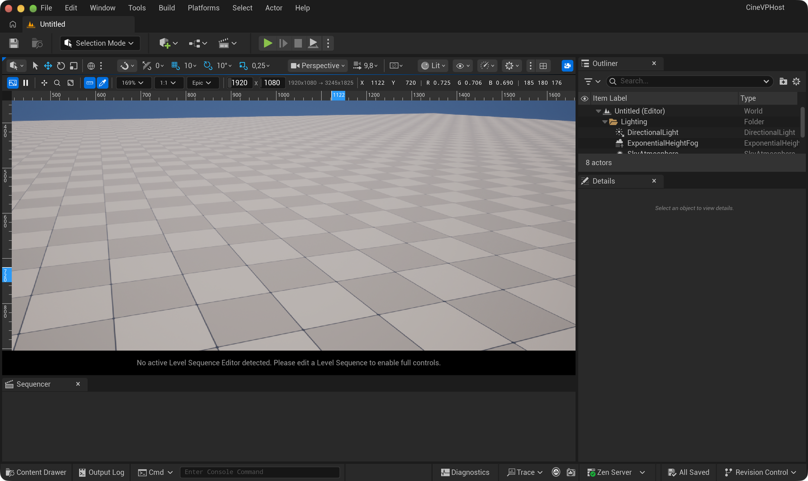

# CineViewPlus

CineViewPlus turns Unreal Engine's Cinematic Viewport into a compositing-style image viewer. The image renders at a fixed resolution, whatever the size of the panel, and you can zoom and pan it in 2D without moving the camera.

## Features

- **Fixed render resolution**, independent of the panel size
- **2D zoom and pan** on the rendered image
- **Pixel-true zoom**, where 100% shows one render pixel per physical screen pixel
- **Hard square pixels** when zoomed above 100%
- **Rulers** in render pixels
- **Eyedropper** with position, float and 8-bit color values
- **Downrez** and engine scalability controls in the viewport
- **Pause** that also works while Sequencer is open
- **Rebindable keyboard shortcuts**

Default viewports are never affected. CineViewPlus only activates on Cinematic Viewports.

## Documentation

1. [Installation](docs/01-installation.md)
2. [Quick start](docs/02-quick-start.md)
3. [The controls bar](docs/03-controls-bar.md)
4. [Resolution and quality](docs/04-resolution-and-quality.md)
5. [Zoom and pan](docs/05-zoom-and-pan.md)
6. [Rulers and eyedropper](docs/06-rulers-and-eyedropper.md)
7. [Settings](docs/07-settings.md)
8. [Keyboard shortcuts](docs/08-keyboard-shortcuts.md)
9. [Troubleshooting and FAQ](docs/09-troubleshooting.md)

Screenshots were taken in Unreal Engine 5.8 on macOS.

## Support

Questions, bug reports and feature requests are handled in this repository's [Issues](https://github.com/francoisgfx/ue-cineviewplus-docs/issues). See [how to get support](SUPPORT.md).
