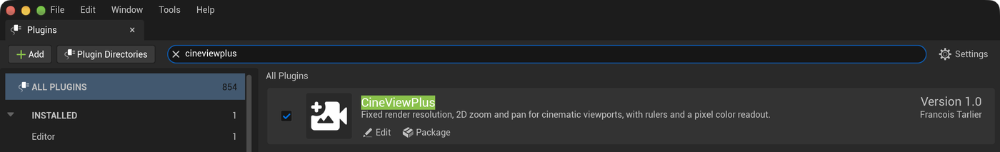

# Installation

## Requirements

| | |
|---|---|
| Unreal Engine | 5.6, 5.7 or 5.8 |
| Type | Editor-only code plugin |
| Runtime impact | None. The plugin is not part of packaged games |

### Platform status

| Platform | UE 5.6 | UE 5.7 | UE 5.8 |
|---|---|---|---|
| macOS | Tested | Tested | Tested |
| Windows (Win64) | Tested | Tested | Tested |

## Install from Fab

1. Add CineViewPlus to your library on [Fab](https://www.fab.com).
2. Open the **Epic Games Launcher** and go to **Unreal Engine > Library**.
3. Find CineViewPlus under **Fab Library**.
4. Click **Install to Engine** and choose your engine version.

## Enable the plugin

1. Open your project.
2. Go to **Edit > Plugins**.
3. Search for **CineViewPlus**.
4. Check **Enabled**.
5. Restart the editor when prompted.

## Check that it works

Switch a viewport to the Cinematic Viewport, as described in the [Quick start](02-quick-start.md). A second toolbar line with the CineViewPlus controls appears under the viewport toolbar.

## Uninstall

1. Go to **Edit > Plugins**, uncheck **CineViewPlus**, and restart the editor.
2. To remove it from the engine, use the engine's installed plugins list in the Epic Games Launcher.

Your CineViewPlus preferences are stored in the project's `Saved/Config` folder.
