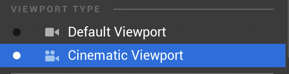
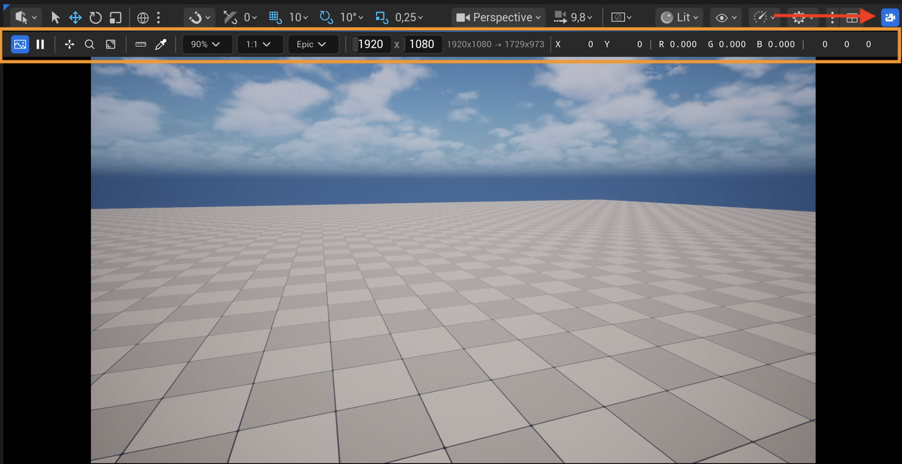
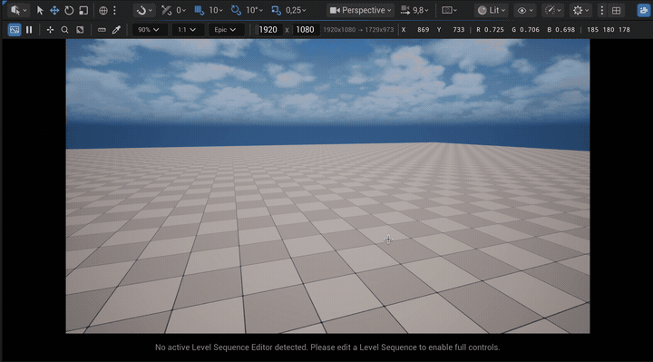

# Quick start

## 1. Open a Cinematic Viewport

In the level viewport, open the **Perspective** dropdown. Under **Viewport Type**, choose **Cinematic Viewport**.

CineViewPlus activates by itself within a moment and adds a controls bar under the viewport toolbar.

## 2. Set your resolution

Type your render size in the **W** and **H** fields of the controls bar and press Enter. The default is 1920 x 1080. The image now renders at that size, whatever the size of the panel.

## 3. Navigate the image

| Action | Input |
|---|---|
| Zoom toward the cursor | Scroll wheel |
| Pan | Middle mouse drag, or Alt + left mouse drag |
| Fit and recenter | Home or Shift+F |
| Zoom to 100% | Alt+Shift+T |

The camera never moves. You are only moving your view of the finished image.

## 4. Turn it off

Click the **CineVP** icon in the main viewport toolbar. The viewport returns to standard Unreal behavior, with no CineViewPlus overhead. Click it again to turn it back on.

Next: [the controls bar](03-controls-bar.md).
