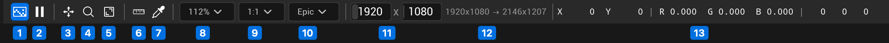

# The controls bar

The controls bar sits directly under the viewport toolbar. It stays in place when you zoom or pan the image, and hides along with the rest of the viewport UI.

The on/off button is separate: the **CineVP** icon stays in the main viewport toolbar, so you can always turn the plugin back on for that viewport. In a narrow pane, Unreal moves it into the toolbar overflow (☰) menu.

| # | Group | Control | What it does | More |
|---|---|---|---|---|
| 1 | Render | **Fixed Resolution** | Renders at exactly W x H | [Resolution](04-resolution-and-quality.md#fixed-res) |
| 2 | | **Pause** | Freezes the image | [Pause](04-resolution-and-quality.md#pause) |
| 3 | Navigation | **Pan tool** | Left drag moves the image | [Tools](05-zoom-and-pan.md#pan-and-zoom-tools) |
| 4 | | **Zoom tool** | Left drag zooms | [Tools](05-zoom-and-pan.md#pan-and-zoom-tools) |
| 5 | | **Fit** | Fits and recenters the image | [Zoom](05-zoom-and-pan.md#fit) |
| 6 | Inspection | **Rulers** | Shows pixel rulers | [Rulers](06-rulers-and-eyedropper.md#rulers) |
| 7 | | **Eyedropper** | Turns color sampling on or off | [Eyedropper](06-rulers-and-eyedropper.md#eyedropper) |
| 8 | Quality | **Zoom %** | Zoom levels and fit modes | [Zoom menu](05-zoom-and-pan.md#zoom-menu) |
| 9 | | **Downrez** | Renders at 1:1 to 1:4 and upscales | [Downrez](04-resolution-and-quality.md#downrez) |
| 10 | | **Scalability** | Sets the engine quality level | [Scalability](04-resolution-and-quality.md#scalability) |
| 11 | Resolution | **W x H** | Fixed render size | [Resolution](04-resolution-and-quality.md#setting-the-resolution) |
| 12 | | **Readout** | `render size → displayed size` | [Readout](04-resolution-and-quality.md#resolution-readout) |
| 13 | Color | **Pixel readout** | Position, float color, 8-bit color | [Eyedropper](06-rulers-and-eyedropper.md#eyedropper) |
