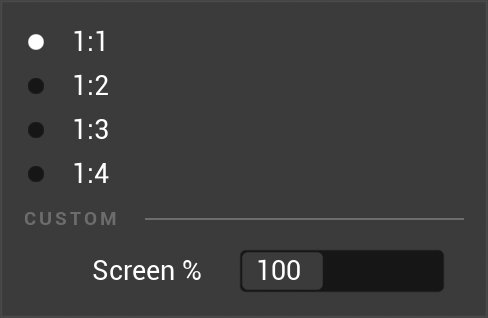
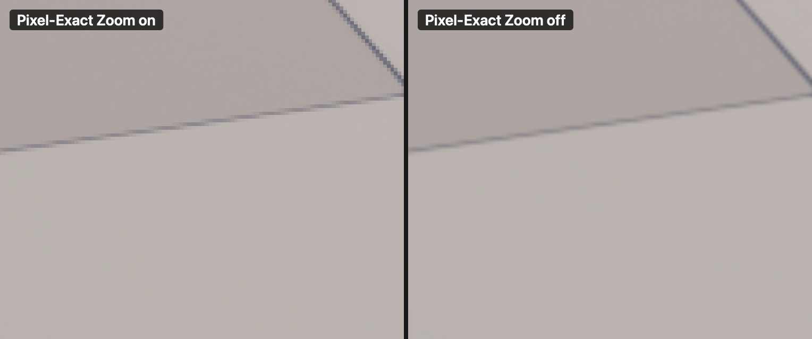

# Resolution and quality

## Fixed Resolution

**Fixed Resolution** (Alt+Shift+X) controls how the image is rendered.

- **On:** the viewport renders at exactly W x H at any panel size.
- **Off:** the render follows the panel size, as in standard Unreal. Downrez still applies. Zoom, pan and object selection keep working.

Turning Fixed Resolution back on shows the image centered at a pixel-true 100%.

Fixed Resolution is not always the slower option, nor always the faster one. A large panel can contain more pixels than your W x H, and a small panel fewer.

While CineViewPlus is active, the screen percentage comes from Downrez in both modes, so the editor's automatic screen percentage cannot silently lower the image quality. Your own value returns when you turn CineViewPlus off.

## Setting the resolution

Type a value in **W** or **H** and press Enter, or drag the field and release.

- The viewport updates when you press Enter or release the drag, not during the drag.
- Dragging stops at 8192. Values up to 16384 must be typed.
- Each Cinematic Viewport has its own resolution.

## Resolution readout

The readout shows the render size, then the size the image covers on your screen:

```
1920x1080 → 1440x810
```

Hover it for details: render size, displayed size, window size, zoom and screen percentage. With Downrez active, the tooltip also shows the internal scene render size.

## Downrez

Downrez renders the scene at a fraction of the fixed resolution and upscales it into the same image size, for faster previews.

| Preset | Screen percentage | Scene size for 1920 x 1080 |
|---|---|---|
| 1:1 | 100% | 1920 x 1080 |
| 1:2 | 50% | 960 x 540 |
| 1:3 | 33% | 634 x 356 |
| 1:4 | 25% | 480 x 270 |

The **Custom** field in the menu accepts any value from 25 to 200, the range of Unreal's own Screen Percentage slider. Downrez and that slider are the same value: changing one updates the other. Downrez applies with Fixed Resolution on or off.



## Scalability

This menu sets all engine scalability groups to **Low**, **Medium**, **High**, **Epic** or **Cinematic**, like **Quick Settings > Engine Scalability**. The button shows **Custom** when the groups are at different levels.

> **Note:** this changes and saves your editor's scalability settings. It affects the whole editor, not only this viewport.

## Pause

**Pause** (Alt+Shift+L) stops continuous rendering and freezes the image, including while Sequencer is open. The image still refreshes on demand. Your Realtime setting is never changed. If Realtime is off, the viewer shows as paused; unpausing it in CineViewPlus runs it until you turn CineViewPlus off, then Realtime is off again.

## Pixel-Exact Zoom

With Fixed Resolution on and the zoom above 100%, each render pixel is displayed as a hard square rather than a smoothed image, so you can inspect aliasing and edges.

This copies each frame into an extra texture, only while the image is shown above 100%.

| Resolution | Extra video memory |
|---|---|
| 1080p | about 8 MB |
| 4K | about 33 MB |
| 8K | about 133 MB |

You can turn it off in [Settings](07-settings.md).


