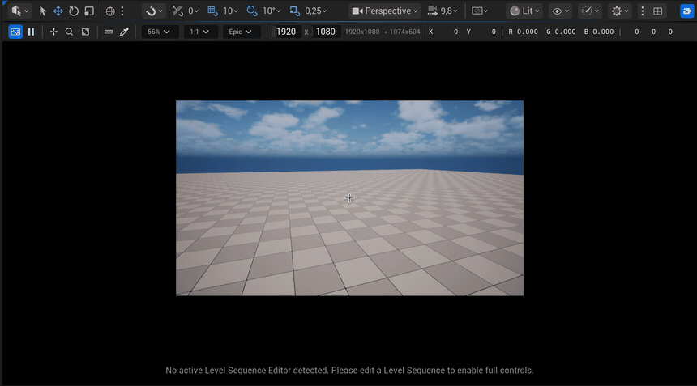
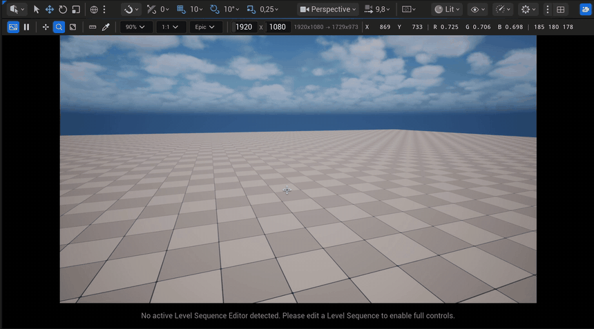
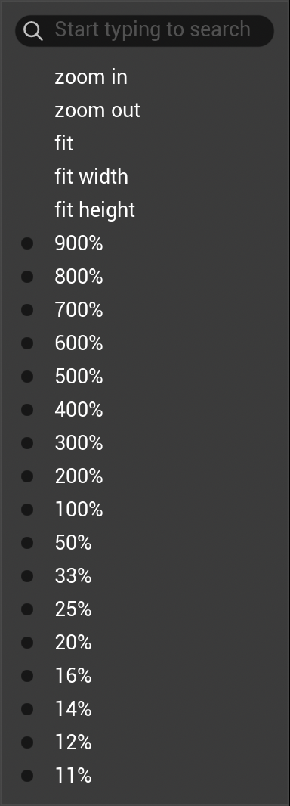

# Zoom and pan

Zoom and pan apply to the finished image. They do not move the camera and do not trigger any extra rendering. Safe frames, grids and other film overlays follow the image.

## Zoom

- **Scroll wheel:** zooms toward the cursor, by 10% per tick.
- **Alt+=** and **Alt+-:** double or halve the zoom.
- **Alt+Shift+T:** zooms to 100%.

Holding the right mouse button while scrolling keeps its usual Unreal function, changing the camera speed.

## Pan

- **Middle mouse drag**
- **Alt + left mouse drag**

> **Note:** in an active Cinematic Viewport, Alt + left drag pans the image instead of orbiting the camera.

## Pan and Zoom tools

These tools are for working without a middle button or a wheel, such as on a trackpad. Only one can be on at a time.

- **Pan tool** (Alt+Shift+N): left drag moves the image.
- **Zoom tool** (Alt+Shift+Z): left drag right zooms in, left drag left zooms out, around the point you pressed.

While either tool is on, left clicks do not select objects. Turn the tool off to select again.

## Fit

The **Fit** button, **Home** or **Shift+F** fits the whole image in the panel and recenters it.

## Zoom menu

The zoom percentage button opens a menu:

| Entry | Effect |
|---|---|
| **zoom in / zoom out** | Doubles or halves the zoom |
| **fit** | Shows the whole image, centered |
| **fit width** | The image width fills the panel, the height may overflow |
| **fit height** | The image height fills the panel, the width may overflow |
| **900% to 11%** | Exact zoom levels, anchored on the center of the view |

Zoom percentages are **pixel-true**: at 100%, one render pixel covers one physical screen pixel, including on Retina and other high-DPI displays. A custom zoom keeps its value when you resize the panel.

## Selecting and moving objects

Clicking objects, box selection and gizmos work normally at any zoom, pan and resolution.
