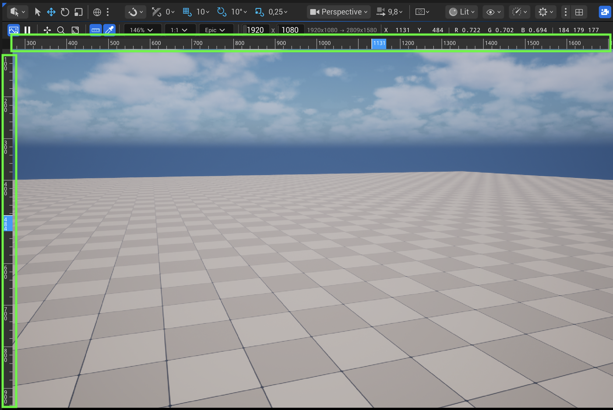

# Rulers and eyedropper

## Rulers

**Rulers** (Alt+Shift+U) adds rulers along the top and left of the image, in render pixels.

- The origin (0, 0) is the top-left corner of the image.
- The ticks follow zoom and pan.
- A marker follows the cursor.
- Rulers are off by default. Your choice is saved.

If the camera's aspect ratio differs from W x H, the rulers span the full render frame, and Unreal adds side bars around the camera image inside that frame.



## Eyedropper

The **Eyedropper** (Alt+Shift+E) reads the pixel under the cursor, about 10 times per second. It is off by default, because each reading makes the editor wait for the GPU.

The readout shows three fields:

```
X   960  Y   540 | R 0.502  G 0.545  B 0.620 | 128 139 158
```

| Field | Content |
|---|---|
| Position | Render pixel, with 0, 0 at the top-left |
| Float | Color from 0 to 1 |
| 8-bit | Color from 0 to 255 |

<video src="images/eyedropper.mp4" autoplay loop muted playsinline preload="metadata" aria-label="Eyedropper sampling pixels on hover, then holding a value on click" style="max-width:100%"><a href="images/eyedropper.mp4">Eyedropper sampling pixels on hover, then holding a value on click</a></video>

### Keep a value

Click the image while the eyedropper is on. CineViewPlus keeps that pixel's value and turns the eyedropper off. The click does not select anything. Clicking outside the image behaves normally.

### Copy a value

Click any of the three fields to copy it as comma-separated values, for example `0.502, 0.545, 0.620`.

### What the values mean

Colors are **display-referred**: they are read after tone mapping, as shown on screen. They are not scene-linear light values, so they will differ from what you would read in a linear EXR. Alpha is not shown, because the viewport's alpha channel is not meaningful.

The readout keeps its last value when the cursor leaves the image, or while you drag or zoom.
