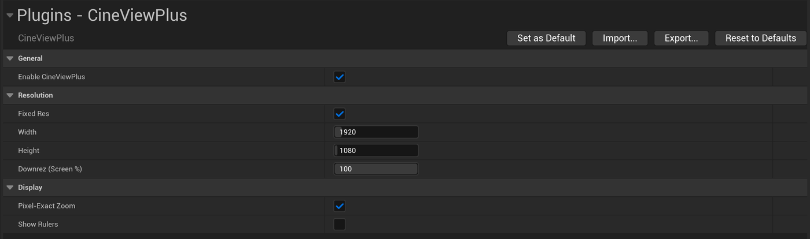

# Settings

Open **Edit > Editor Preferences > Plugins > CineViewPlus**.

| Setting | Default | Description |
|---|---|---|
| **Enable CineViewPlus** | On | Same as the CineVP button in the viewport toolbar |
| **Fixed Res** | On | Render at exactly Width x Height |
| **Width** | 1920 | Fixed render width, 1 to 16384 |
| **Height** | 1080 | Fixed render height, 1 to 16384 |
| **Downrez (Screen %)** | 100 | Scene render percentage, 25 to 100 |
| **Pixel-Exact Zoom** | On | Hard square pixels above 100% zoom |
| **Show Rulers** | Off | Rulers along the top and left of the image |

Settings are saved per user and per project, in the project's `Saved/Config` folder. Changes made from the controls bar are saved automatically.

## Not saved

These reset for each session: zoom, pan, Pause, the eyedropper, and the Pan and Zoom tools.
