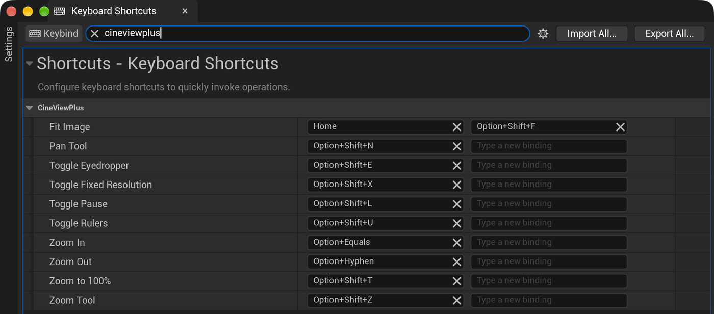

# Keyboard shortcuts

On macOS, **Alt** is the **Option** key.

| Action | Default shortcut |
|---|---|
| Fit image | Home or Alt+Shift+F |
| Zoom to 100% | Alt+Shift+T |
| Zoom in | Alt+= |
| Zoom out | Alt+- |
| Toggle Fixed Resolution | Alt+Shift+X |
| Toggle Pause | Alt+Shift+L |
| Pan tool | Alt+Shift+N |
| Zoom tool | Alt+Shift+Z |
| Toggle rulers | Alt+Shift+U |
| Toggle eyedropper | Alt+Shift+E |

## Mouse

| Action | Input |
|---|---|
| Zoom toward the cursor | Scroll wheel |
| Pan | Middle mouse drag or Alt + left mouse drag |
| Pan with the Pan tool | Left mouse drag |
| Zoom with the Zoom tool | Left mouse drag right or left |
| Keep a color, eyedropper on | Left click on the image |

## Change a shortcut

1. In UE 5.8, go to **Edit > Keyboard Shortcuts**. In UE 5.6 and 5.7, go to **Edit > Editor Preferences > Keyboard Shortcuts**.
2. Search for **CineViewPlus**.
3. Click a shortcut and press the new keys.

## When shortcuts work

The viewport must have keyboard focus, so click the image first. Shortcuts do not fire while you type in a text field or while a menu is open.

The CineVP on/off button has no shortcut.
